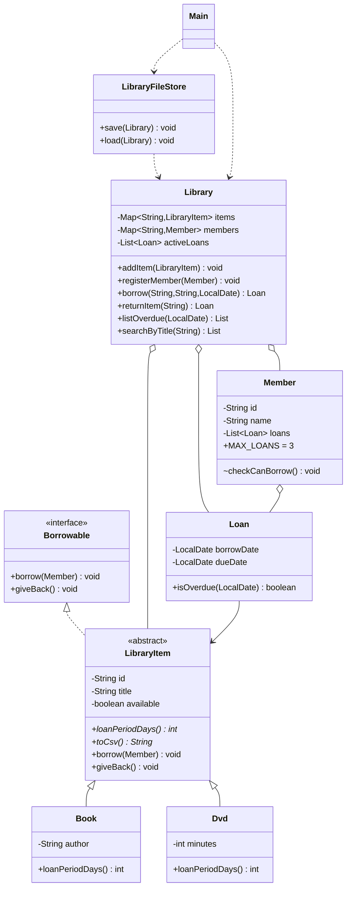

# Java OOP Lab Manual: Complete Solutions (Labs 1 to 11 mini-project)

Everything for the OOP in Java lab manual in one file: how to set up and run the project, a list of every file, my assumptions,
and the lab record notes (expected output and written explanations) for Labs 1 to 10 and the Library Management System mini-project.
All programs were compiled and run with JDK 21.

## Contents

1. [Part 1: Setup and how to run](#part-1-setup-and-how-to-run)
2. [Part 2: Labs 1, 2 and the Library mini-project](#part-2-labs-1-2-and-the-library-mini-project)
3. [Part 3: Labs 3 to 6](#part-3-labs-3-to-6)
4. [Part 4: Labs 7 to 10](#part-4-labs-7-to-10)

---

# Part 1: Setup and how to run

Every lab is its own **package**, so classes with the same name in different labs (for example `Student` in Labs 3, 4, 6 and 10)
no longer clash.

    java-lab-solutions-vscode/
        src/
            lab1/ ... lab10/        Labs 1 to 10  (package lab1 ... lab10)
            library/                Library Management System mini-project (package library)
        notes/                      The same lab record notes as separate files (also in Parts 2 to 4 below)
        learners.csv, sample.txt    Data files used by Lab 10 (they must stay in this folder)
        .vscode/settings.json       Tells VS Code that `src` is the source folder

## Open it in VS Code

1. Install JDK 17 or later and the **Extension Pack for Java** (once).
2. **File > Open Folder** and choose `java-lab-solutions-vscode` itself (not its parent folder, and not a single lab folder).
3. Open any file that has a `main` method and click **Run** above `main` (or press Ctrl+F5).
   VS Code runs from the project folder, which is where `learners.csv` and `sample.txt` are, so Lab 10 works.

If red errors are still showing after you open the folder: press Ctrl+Shift+P, run **Java: Clean Java Language Server Workspace**, choose *Restart and delete*, and wait for it to reload.

## Run from a terminal instead

Run these from the `java-lab-solutions-vscode` folder. Class names include the package name.

    javac -d bin src/lab3/*.java
    java -cp bin lab3.Student

    javac -d bin src/lab10/*.java
    java -cp bin lab10.TextStats

    javac -d bin src/library/*.java
    java -cp bin library.Main

(The Library program saves its data in a `library-data` folder inside the folder you run it from.)

## If you copy a file into your own project

The first line of each file says which package it belongs to (for example `package lab7;`).
The package name must match the folder the file sits in under `src`. If you move a file, change that first line to match, or delete the line if the file is directly inside the source folder.

## Every file in the project

- **`src/lab1/`** (Classes and objects): `Address.java`, `Car.java`, `Person.java`, `PersonDemo.java`, `Rectangle.java`, `RectangleAliasDemo.java`
- **`src/lab2/`** (Constructors, this, static): `Circle.java`, `Employee.java`, `InitBlocksDemo.java`, `Temperature.java`
- **`src/lab3/`** (Encapsulation): `BankAccount.java`, `BankDemo.java`, `ImmutablePerson.java`, `Student.java`, `Temperature.java`, `TemperatureDemo.java`, `TemperatureFahrenheit.java`
- **`src/lab4/`** (Inheritance): `Animal.java`, `BadStack.java`, `BrokenDog.txt`, `Car.java`, `Dog.java`, `ElectricCar.java`, `GoodStack.java`, `Person.java`, `SchoolDemo.java`, `StackDemo.java`, `Student.java`, `Teacher.java`, `Vehicle.java`, `VehicleChainDemo.java`
- **`src/lab5/`** (Polymorphism): `Animal.java`, `AnimalDemo.java`, `CardPayment.java`, `CashPayment.java`, `Cat.java`, `Child.java`, `Cow.java`, `Developer.java`, `Duck.java`, `Employee.java`, `FieldVsMethodDemo.java`, `Intern.java`, `Manager.java`, `MobileMoneyPayment.java`, `Parent.java`, `Payment.java`, `PaymentDemo.java`, `PaymentProcessor.java`, `PaymentProcessor2.java`, `PayrollDemo.java`, `Printer.java`
- **`src/lab6/`** (Abstraction and interfaces): `Account.java`, `AccountDemo.java`, `Aeroplane.java`, `Bird.java`, `BothGreeter.java`, `Circle.java`, `CurrentAccount.java`, `FlyDemo.java`, `Flyable.java`, `Greeter1.java`, `Greeter2.java`, `MarksComparator.java`, `Rectangle.java`, `SavingsAccount.java`, `Shape.java`, `ShapeDemo.java`, `SortDemo.java`, `Square.java`, `Student.java`
- **`src/lab7/`** (Exception handling): `AgeValidator.java`, `ArrayAccess.java`, `BankAccount.java`, `BankDemo.java`, `FinallyDemo.java`, `InsufficientFundsException.java`, `InvalidAgeException.java`, `SafeDivide.java`
- **`src/lab8/`** (Generics and collections): `BubbleSortDemo.java`, `NumberList.java`, `RemoveDuplicates.java`, `Stack.java`, `WordFrequency.java`
- **`src/lab9/`** (Nested types, enums, records, equals/hashCode): `Book.java`, `BookNoHash.java`, `BookSetDemo.java`, `Coin.java`, `Level.java`, `LevelDemo.java`, `MyLinkedList.java`, `RecordDemo.java`
- **`src/lab10/`** (File I/O, lambdas, streams): `AboveAverage.java`, `LearnerReports.java`, `NotesFile.java`, `RemoveEvens.java`, `TextStats.java`
- **`src/library/`** (Library Management System mini-project): `Book.java`, `Borrowable.java`, `Dvd.java`, `ItemNotAvailableException.java`, `Library.java`, `LibraryFileStore.java`, `LibraryItem.java`, `Loan.java`, `Main.java`, `Member.java`, `MemberLimitExceededException.java`, `Validation.java`

## Assumptions I made (the manual does not specify these)

| Where | Assumption | Where to change it |
|---|---|---|
| Lab 1, `Car.isAntique()` | Antique means more than 25 years old, measured from today's year | `Car.java` |
| Lab 3, `Student.getGrade()` | A = 70+, B = 60 to 69, C = 50 to 59, F = below 50 | `lab3/Student.java` |
| Lab 5, `Intern` | Pay = stipend + a fixed 50 transport allowance | `lab5/Intern.java` |
| Lab 10, `LearnerReports` | Band A = GPA 3.5+, B = 3.0 to 3.49, C = below 3.0 | `Learner.band()` in `lab10/LearnerReports.java` |
| Library project | Titles and names cannot contain the `|` character (it separates fields in the data files) | `library/Validation.java` |

---

# Part 2: Labs 1, 2 and the Library mini-project

All programs were compiled and run with JDK 21. To run any program, see Part 1 (Setup and how to run). Class names include the lab's package, for example `lab3.Student`, and the "Run with" column below shows the class name without it.

---

## Lab 1: Classes and Objects

| Exercise | File | Run with |
|---|---|---|
| Basic 1 and 2: `Car`, `display()`, `isAntique()` | `Car.java` | `java Car` |
| Intermediate 1: `Rectangle`, array of 5, largest area | `Rectangle.java` | `java Rectangle` |
| Intermediate 2: aliasing | `RectangleAliasDemo.java` | `java RectangleAliasDemo` |
| Challenge: `Person` has an `Address`, null case | `Address.java`, `Person.java`, `PersonDemo.java` | `java PersonDemo` |

**Expected output: Car** (isAntique uses today's year, so the results are for 2026)

    Brand: Toyota, Year: 1988, Mileage: 250000 km
    Brand: Mazda, Year: 2015, Mileage: 90000 km
    Brand: Honda, Year: 2020, Mileage: 35000 km
    Toyota antique? true
    Mazda antique? false
    Honda antique? false

**Expected output: Rectangle**

    Rectangle 1: 2.0 x 3.0  area = 6.0  perimeter = 10.0
    Rectangle 2: 5.0 x 4.0  area = 20.0  perimeter = 18.0
    Rectangle 3: 10.0 x 1.0  area = 10.0  perimeter = 22.0
    Rectangle 4: 6.0 x 6.0  area = 36.0  perimeter = 24.0
    Rectangle 5: 3.0 x 7.0  area = 21.0  perimeter = 20.0
    Largest: 6.0 x 6.0 (area 36.0)

**Expected output: RectangleAliasDemo**

    r1.width = 10.0
    Same object? true

**Explanation for the lab record (aliasing):**
Prediction: `r1.width` prints **10.0**, not 5.0. A variable like `r1` does not hold the rectangle; it holds a reference
(an address) to a Rectangle object on the heap. The line `Rectangle r2 = r1;` copies that address, not the object, so
`r1` and `r2` are two names for the same single object. Changing `r2.width` changes the one shared object, and `r1`
sees the change. `r1 == r2` is `true` because `==` compares addresses and they are identical.

**Expected output: PersonDemo**

    Tariro lives in Harare
    Oops! Farai has no address, so address.city crashed: NullPointerException
    Farai has no address on record.

**Explanation (null):** A `Person`'s `address` field starts as `null`, meaning "refers to no object". Writing
`farai.address.city` asks Java to follow a reference that goes nowhere, which throws `NullPointerException`. The fix is
to test `if (farai.address == null)` before using the chained dot.

---

## Lab 2: Constructors, `this` and `static`

| Exercise | File | Run with |
|---|---|---|
| Basic 1 and 2: `Circle`, default radius, static counter | `Circle.java` | `java Circle` |
| Intermediate 1: `Employee` (auto-id, 3 constructors, copy constructor) | `Employee.java` | `java Employee` |
| Intermediate 2: two static + two instance blocks | `InitBlocksDemo.java` | `java InitBlocksDemo` |
| Challenge: `Temperature` static factories | `Temperature.java` | `java Temperature` |

**Expected output: Circle**

    Circles at start: 0
    small area = 3.14
    big area   = 95.03
    Circles created: 2

**Expected output: Employee**

    ID 1 | Tariro | IT | $1200.50
    ID 2 | Farai | Finance | $0.00
    ID 3 | Rudo | Unassigned | $0.00
    ID 4 | Tariro | IT | $1200.50
    e1 and e4 same object? false

Only one constructor hands out an id (`nextId`); the other three call it using `this(...)`, so the id is assigned
exactly once per object. The copy constructor makes a new employee with the same details, so it gets its own new id.

**Expected output: InitBlocksDemo**

    static block 1
    static block 2
    main starts
    --- first object ---
    instance block 1
    instance block 2
    constructor
    --- second object ---
    instance block 1
    instance block 2
    constructor

**Explanation:** Static blocks run **once**, when the class is first loaded, which happens before `main` begins, in the
order they are written. Instance blocks run **every time** an object is created, in the order written, before the
constructor body.

**Expected output: Temperature**

    Boiling water: 100.0 C / 212.0 F
    Body temperature: 37.0 C / 98.6 F

**Why static factories can be clearer than overloaded constructors:**
1. `new Temperature(30)` does not say whether 30 is Celsius or Fahrenheit, and you cannot write two constructors
   `Temperature(double celsius)` and `Temperature(double fahrenheit)` because they have the same signature.
   `fromCelsius(30)` and `fromFahrenheit(86)` have names that say exactly what they mean.
2. The constructor can stay `private`, so every Temperature is created through a controlled, named entry point.

---

## Mini-Project: Library Management System

Folder: `src/library/`. Run `library.Main` (see Part 1).
Saved data goes in a `library-data/` folder (three text files) created next to where you run the program.

### Requirement checklist

| Requirement | Where it is done |
|---|---|
| `Book`, `Member`, `Loan` with private fields, validation, `toString` | `Book.java`, `Member.java`, `Loan.java`, `Validation.java` |
| Abstract `LibraryItem`, subclasses `Book` and `Dvd` with `loanPeriodDays()` | `LibraryItem.java` (abstract), `Book.java` (21 days), `Dvd.java` (7 days) |
| `Borrowable` interface with `borrow(Member)` and `giveBack()` | `Borrowable.java`, implemented by `LibraryItem` |
| Custom exceptions, maximum 3 loans | `ItemNotAvailableException`, `MemberLimitExceededException`, `Member.MAX_LOANS` |
| Items and members in `Map<String, ...>` keyed by id | `Library.java` |
| CSV persistence: save on exit, reload on start | `LibraryFileStore.java`, called from `Main.java` |
| Menu: add item, register member, borrow, return, overdue, search (streams) | `Main.java`; streams in `Library.listOverdue` and `Library.searchByTitle` |

### Class diagram (Mermaid)

Paste into https://mermaid.live to draw it as a picture for your submission.

### How each OOP idea is used (for the short report and the viva)

- **Encapsulation:** every field is `private`. `Member.getLoans()` returns a read-only view, and the checks live inside
  the classes (the constructors validate their input, `Member.checkCanBorrow()` enforces the 3-loan limit).
- **Inheritance:** `Book` and `Dvd` extend `LibraryItem` and reuse its id, title and availability code through `super(...)`.
- **Abstraction:** `LibraryItem` is abstract, so you cannot create a generic item, and `Borrowable` describes
  *what* can be done to an item without saying *how*.
- **Polymorphism:** `Loan` calls `item.loanPeriodDays()` without knowing whether it holds a Book (21) or a Dvd (7), and
  `LibraryFileStore` calls `item.toCsv()` the same way. The right version runs at run time.
- **Exceptions:** two checked custom exceptions for rule-breaking, `IllegalArgumentException` for bad input (unknown
  id, blank title), and `IOException` for file problems.
- **Collections and streams:** `Map` keyed by id for fast lookup; `filter` / `sorted` / `toList` for overdue and search.
- **File persistence:** on exit, three files are written (`items.csv`, `members.csv`, `loans.csv`); on start they are
  read back in the order items, members, loans, and each saved loan is re-created through `Library.borrow(...)`, so the
  same rules are checked again. If a file is corrupted, the program stops instead of overwriting your data.

### Sample test session (what was run)

1. Added 3 books and 2 DVDs; adding a duplicate id was rejected.
2. Registered 2 members; borrowed a book dated 2026-09-01 (due 2026-09-22), so "List overdue" showed it.
3. A 4th loan for the same member gave `MemberLimitExceededException` ("already has 3 loans").
4. Borrowing an item already on loan gave `ItemNotAvailableException`.
5. Search for "java" returned 3 items sorted by title.
6. Exited, restarted: "Loaded 5 items, 2 members, 3 active loans", and returning the overdue book worked.

### Known limitations (mention in the report)

- The `|` character is not allowed in titles or names, because it separates fields in the data files.
- Ids are typed by the user and are case-sensitive.
- Overdue status is checked against today's date, so the "borrow date" prompt is how you test it.

---

# Part 3: Labs 3 to 6

All programs were compiled and run with JDK 21. To run any program, see Part 1 (Setup and how to run). Class names include the lab's package, for example `lab3.Student`, and the "Run with" column below shows the class name without it.

Each lab folder is separate, so the same class name (for example `Student` or `Circle`) can appear in more than one lab.

---

## Lab 3: Encapsulation and Access Modifiers

| Exercise | Files | Run with |
|---|---|---|
| Basic 1 and 2: `Student` with validated marks and a calculated grade | `Student.java` | `java Student` |
| Intermediate 1: `BankAccount` with transaction history | `BankAccount.java`, `BankDemo.java` | `java BankDemo` |
| Intermediate 2: `ImmutablePerson` | `ImmutablePerson.java` | `java ImmutablePerson` |
| Challenge: `Temperature` stored in kelvin | `Temperature.java`, `TemperatureFahrenheit.java`, `TemperatureDemo.java` | `java TemperatureDemo` |

**Expected output: Student**

    Tendai: 72 (A)
    Tendai: 55 (C)
    Rejected: Marks must be between 0 and 100, but got 120
    Marks are still 55
    95 -> A
    70 -> A
    69 -> B
    60 -> B
    59 -> C
    50 -> C
    49 -> F
    0 -> F

The manual does not give grade boundaries, so I assumed A = 70+, B = 60 to 69, C = 50 to 59, F = below 50. Change them in
`getGrade()` to match your course. There is no `grade` field: the grade is worked out from `marks` each time, so it can never
disagree with the marks.

**Expected output: BankDemo**

    ACC-001 [Tendai] balance: 650.00
    --- history ---
    Opened with 500.00
    Deposit 250.00
    Withdrawal 100.00
    Failed withdrawal of 5000.00 (insufficient funds)
    History copy is read-only: clear() blocked
    Old copy size: 4, real history size: 5

`getTransactionHistory()` returns `List.copyOf(history)`: a new, read-only list. The caller cannot change our real list
(`clear()` is blocked), and the copy is a snapshot, so the deposit made afterwards shows in the real history (5 entries) but not in the old copy (4).

**Expected output: ImmutablePerson**

    Rudo (20), hobbies: [football]
    Rudo (20), hobbies: [football]
    Rudo (21), hobbies: [football]

**Design choices explained (numbers match the comments in the code):**
1. **`final` class:** a subclass could add setters or override getters and break the "never changes" promise.
2. **`private final` fields:** `private` stops outside code touching them, `final` means they are assigned once in the constructor and never again.
3. **Validation in the constructor:** the object is checked once when it is created, so an invalid `ImmutablePerson` can never exist.
4. **Defensive copy in:** `new ArrayList<>(hobbies)` copies the caller's list. Without it the caller could keep their own reference and change our hobbies later (in the demo, `myHobbies.add("chess")` did not affect the person).
5. **Defensive copy out:** `getHobbies()` returns a read-only copy, so callers cannot change the internal list through the getter (the same trap as Program 3.2).
6. **No setters:** nothing can change the state. "Changing" a person means creating a new one, like `withAge(21)`.

**Expected output: TemperatureDemo**

    Kelvin version:     25.00 C / 77.00 F   getCelsius() = 25.0
    Fahrenheit version: 25.00 C / 77.00 F   getCelsius() = 25.0
    Absolute zero: -273.15 C / -459.67 F
    Rejected: Below absolute zero (-273.15 C) is impossible: -300.0

**Challenge explanation:** `Temperature` keeps its value in kelvin (`private final double kelvin`) and rejects anything below
absolute zero in the constructor. Callers only ever use `getCelsius()` and `getFahrenheit()`. In `TemperatureFahrenheit.java` I changed
the hidden unit to Fahrenheit but kept the same public methods; the calling lines in `TemperatureDemo` are identical and give identical
results. That is the benefit of encapsulation: the **inside** can change without breaking the **outside**.
If `kelvin` had been a public field, every caller using it would have broken.

---

## Lab 4: Inheritance

| Exercise | Files | Run with |
|---|---|---|
| Basic 1 and 2: `Person`, `Student`, `Teacher` | `Person.java`, `Student.java`, `Teacher.java`, `SchoolDemo.java` | `java SchoolDemo` |
| Intermediate 1: `Vehicle` > `Car` > `ElectricCar` | `Vehicle.java`, `Car.java`, `ElectricCar.java`, `VehicleChainDemo.java` | `java VehicleChainDemo` |
| Intermediate 2: `Dog extends Animal` compile error | `Animal.java`, `Dog.java` (fixed), `BrokenDog.txt` (broken) | `java Dog` |
| Challenge: `Stack` by inheritance vs composition | `BadStack.java`, `GoodStack.java`, `StackDemo.java` | `java StackDemo` |

**Expected output: SchoolDemo**

    --- display() written once in Person ---
    Name: Chipo, Age: 40
    Name: Tariro, Age: 19
    Name: Mr Moyo, Age: 45
    --- extra things each subclass adds ---
    Tariro studies Computer Science
    Mr Moyo teaches Mathematics
    --- loop over Person[] ---
    Name: Chipo, Age: 40
    Name: Tariro, Age: 19
    Name: Mr Moyo, Age: 45

`display()` is written once in `Person`. `Student` and `Teacher` do not contain it, yet both can call it because they inherit it.
Each subclass adds only what is new (`course`, `subject`).

**Expected output: VehicleChainDemo**

    Creating an ElectricCar...
    1. Vehicle constructor (brand = Tesla)
    2. Car constructor (doors = 4)
    3. ElectricCar constructor (battery = 75 kWh)
    Done. Tesla has 4 doors and a 75 kWh battery.

The constructors run from the top of the chain down. `new ElectricCar(...)` first calls `super(...)` into `Car`, which first calls `super(...)` into `Vehicle`.
`Vehicle` finishes first, then `Car`, then `ElectricCar`.

**Why `Dog extends Animal` fails when `Animal` only has `Animal(String name)`:**
Once you write any constructor, Java no longer supplies the hidden no-argument one. A subclass constructor must start by calling a superclass constructor.
If you do not write `super(...)`, Java inserts `super();` for you, and `Animal` has no `Animal()`. Real compiler message from `BrokenDog.txt`:

    Dog.java:4: error: constructor Animal in class Animal cannot be applied to given types;
        public Dog(String name) {
                                ^
      required: String
      found:    no arguments
      reason: actual and formal argument lists differ in length

Fix (this is `Dog.java`): write `super(name);` as the first line of the `Dog` constructor.

**Expected output: Dog (fixed version) and StackDemo**

    Rex says Woof

    BadStack after sneaky calls: [SNEAKY, second, third]
    BadStack pop() returned: third
    GoodStack peek: third
    GoodStack pop order: third, second, first
    GoodStack empty now? true

**What the inheritance version wrongly exposes:** `BadStack extends ArrayList<String>` inherits **every** `ArrayList` method, so callers can
use `add(0, x)`, `remove(1)`, `get(i)`, `set(i, x)`, `clear()`, `sort(...)` and many more. In the demo `add(0, "SNEAKY")` put an item at the **bottom** and
`remove(1)` removed one from the **middle**, which a real stack must never allow (Last-In-First-Out is broken). A stack is not a kind of list, so the
"is-a" test fails. `GoodStack` **has-a** private list and exposes only `push`, `pop`, `peek`, `isEmpty` and `size`, so the rule cannot be broken from outside. It could even change its
inside to a different structure later without breaking callers.

---

## Lab 5: Polymorphism

| Exercise | Files | Run with |
|---|---|---|
| Basic 1: overloaded `print` | `Printer.java` | `java Printer` |
| Basic 2: `Animal`, `Cat`, `Cow`, `Duck` | `Animal.java`, `Cat.java`, `Cow.java`, `Duck.java`, `AnimalDemo.java` | `java AnimalDemo` |
| Intermediate 1: payroll with `Intern` | `Employee.java`, `Manager.java`, `Developer.java`, `Intern.java`, `PayrollDemo.java` | `java PayrollDemo` |
| Intermediate 2: field versus method | `Parent.java`, `Child.java`, `FieldVsMethodDemo.java` | `java FieldVsMethodDemo` |
| Challenge: `PaymentProcessor` two designs | `Payment.java`, `CardPayment.java`, `MobileMoneyPayment.java`, `CashPayment.java`, `PaymentProcessor.java`, `PaymentProcessor2.java`, `PaymentDemo.java` | `java PaymentDemo` |

**Expected output: Printer**

    int: 42
    double: 3.14
    String: hello
    int[]: [1, 2, 3]
    double: 7.0

The compiler chooses the version from the argument types. The last call passes a `long`; there is no `print(long)`, so Java widens it to the closest match that fits, `print(double)`.

**Expected output: AnimalDemo**

    Cat says Meow
    Cow says Moo
    Duck says Quack
    Animal says (some animal sound)

**Expected output: PayrollDemo**

    Kudzai   Employee    2000.00
    Nyasha   Manager     4300.00
    Tatenda  Developer   3250.00
    Ruvimbo  Intern       450.00
    Total payroll: 10000.00

`totalPayroll(Employee[])` was written before `Intern` existed and was **not changed**. It just calls `calculatePay()`, and the JVM runs the version belonging to each object's real class.
(I removed the constructor `println` lines from the Lab 4 hierarchy so the payroll output is clean; the Intern pays stipend + a fixed 50 transport allowance, which is my assumption.)

**Expected output: FieldVsMethodDemo**

    Child method
    Parent field
    Child field

**Explanation:** `p` is declared as `Parent` but holds a `Child`. The **method** call `p.getLabel()` is polymorphic: Java looks at the actual object, so it prints "Child method".
**Fields are not polymorphic**: `p.label` is decided by the *declared* type (`Parent`), so it prints "Parent field". The `Child` really has two fields called `label`
(the child's one hides the parent's, it does not replace it), and which one you reach depends on the type of the variable. That is also why fields should be `private` and accessed through methods.

**Expected output: PaymentDemo** (design 1 = `instanceof`, then design 2 = polymorphism, for each payment)

    [design 1] Charging card ending 4321
    Charging 100.0 to card ending 4321
    ---
    [design 1] Requesting money from wallet 0771234567
    Requesting 25.5 from mobile wallet 0771234567
    ---
    [design 1] Unknown payment type: CashPayment
    Receiving 10.0 in cash
    ---

**Comparing the two designs:**

| | Design 1: `instanceof` in `PaymentProcessor` | Design 2: `process()` in `PaymentProcessor2` |
|---|---|---|
| Adding a new payment type | Must edit the processor, or it says "Unknown payment type" (see `CashPayment`) | Write the new class only; the processor is untouched |
| Where the logic lives | In one big if/else chain in the processor | Inside each payment class, next to its own data |
| Risk | Easy to forget a type, and the mistake only shows at run time | The compiler/design makes each class provide its behaviour |
| Principle | Breaks open/closed (open for extension, closed for modification) | Follows open/closed |

Design 2 is usually better. `instanceof` is still sensible when you cannot change the classes (a library) or when the behaviour does not belong inside them.

---

## Lab 6: Abstraction, Abstract Classes and Interfaces

| Exercise | Files | Run with |
|---|---|---|
| Basic 1: abstract `Shape` | `Shape.java`, `Circle.java`, `Rectangle.java`, `Square.java`, `ShapeDemo.java` | `java ShapeDemo` |
| Basic 2: `Flyable` interface | `Flyable.java`, `Bird.java`, `Aeroplane.java`, `FlyDemo.java` | `java FlyDemo` |
| Intermediate 1: abstract `Account` | `Account.java`, `SavingsAccount.java`, `CurrentAccount.java`, `AccountDemo.java` | `java AccountDemo` |
| Intermediate 2: `Comparable` and `Comparator` | `Student.java`, `MarksComparator.java`, `SortDemo.java` | `java SortDemo` |
| Challenge: two default methods | `Greeter1.java`, `Greeter2.java`, `BothGreeter.java` | `java BothGreeter` |

**Expected output: ShapeDemo**

    Circle     area =   78.54   perimeter =  31.42
    Rectangle  area =   24.00   perimeter =  20.00
    Square     area =    9.00   perimeter =  12.00

**Expected output: FlyDemo**

    The bird flaps its wings and flies
    The aeroplane takes off using its engines

`Bird` and `Aeroplane` have no common parent, but both are `Flyable`, so one `Flyable[]` can hold them. This is why an interface suits a *capability* shared by unrelated classes, while an abstract class suits closely related classes that share code and state (like `Account`).

**Expected output: AccountDemo**

    Before fee: SavingsAccount SAV-1 balance: 1500.00
    After fee:  SavingsAccount SAV-1 balance: 1498.00  (fee was 2.0)
    Before fee: CurrentAccount CUR-1 balance: 1500.00
    After fee:  CurrentAccount CUR-1 balance: 1490.00  (fee was 10.0)

`applyMonthlyFee()` is written once in `Account` and calls the abstract `monthlyFee()`. The parent does not know which fee it will get; each subclass supplies its own.

**Expected output: SortDemo**

    By name:         [Anesu(70), Blessing(95), Chenai(82), Farai(88)]
    By marks (high): [Blessing(95), Farai(88), Chenai(82), Anesu(70)]

`Comparable` (method `compareTo`) defines the one *natural* ordering inside the class (by name). A `Comparator` (method `compare`) is a separate object that defines any other ordering (by marks), so you can have as many as you like.

**Expected output: BothGreeter**

    Hello from Greeter1
    Hello from Greeter2
    Hello from BothGreeter itself

**The default-method conflict rule:** if a class inherits two default methods with the same signature from two unrelated interfaces, Java refuses to guess. Without its own `hello()`, the class does not compile:

    BothGreeter.java:1: error: types Greeter1 and Greeter2 are incompatible;
    public class BothGreeter implements Greeter1, Greeter2 { }
           ^
      class BothGreeter inherits unrelated defaults for hello() from types Greeter1 and Greeter2

The class must override `hello()` itself. Inside it, `Greeter1.super.hello()` (or `Greeter2.super.hello()`) calls a chosen parent's version. (Related rules: a method in the class or a superclass always beats an interface default, and if one interface extends the other, the more specific one wins.)

---

## Viva practice for these labs

- **Encapsulation:** Why are fields private? Why does `ImmutablePerson` copy the list twice (in and out)?
- **Inheritance:** In what order do constructors run? Why did `Dog` fail to compile? When is composition better than inheritance?
- **Polymorphism:** Overloading versus overriding: which is decided at compile time? Why does `p.label` print the parent's field?
- **Abstraction:** Abstract class versus interface: when do you pick each? What does `Greeter1.super.hello()` mean?

---

# Part 4: Labs 7 to 10

All programs were compiled and run with JDK 21. To run any program, see Part 1 (Setup and how to run). Class names include the lab's package, for example `lab3.Student`, and the "Run with" column below shows the class name without it.

Programs that read the keyboard are shown with the input that was typed. Lab 10 programs read and write files in the folder you run them from,
so run them from the project folder (it contains `learners.csv` and `sample.txt`; the Run button in VS Code already does this).

---

## Lab 7: Exception Handling

| Exercise | Files | Run with |
|---|---|---|
| Basic 1: safe division from the keyboard | `SafeDivide.java` | `java SafeDivide` |
| Basic 2: array index error | `ArrayAccess.java` | `java ArrayAccess` |
| Intermediate 1: `InvalidAgeException` | `InvalidAgeException.java`, `AgeValidator.java` | `java AgeValidator` |
| Intermediate 2: `BankAccount` throws `InsufficientFundsException` | `BankAccount.java`, `InsufficientFundsException.java`, `BankDemo.java` | `java BankDemo` |
| Challenge: `return` in `try` and `finally` | `FinallyDemo.java` | `java FinallyDemo` |

**Expected output: SafeDivide** (three runs; the inputs typed were `10` and `2`, then `10` and `0`, then `abc`)

    Enter the first integer: Enter the second integer: 10 / 2 = 5
    Done.

    Enter the first integer: Enter the second integer: You cannot divide by zero.
    Done.

    Enter the first integer: That was not a whole number. Please type digits only.
    Done.

`Integer.parseInt` throws `NumberFormatException` for text, and `a / b` throws `ArithmeticException` when `b` is 0 (integer division only). Each problem has its own `catch`,
so the user gets a specific message. `finally` printed "Done." in all three runs.

**Expected output: ArrayAccess**

    Element 1 = 20
    Bad index 5: Index 5 out of bounds for length 3
    Element 5 = -1
    Bad index -1: Index -1 out of bounds for length 3
    Element -1 = -1

The exception message already says which index and how long the array is. Negative indexes fail too.

**Expected output: AgeValidator**

    Age 25 is valid
    Age 0 is valid
    Age 120 is valid
    Rejected: Invalid age -5: must be between 0 and 120
    Rejected: Invalid age 121: must be between 0 and 120

`InvalidAgeException extends Exception`, so it is **checked**: the compiler forces every caller to catch it or declare `throws`. The boundaries 0 and 120 are valid; -5 and 121 are rejected.
The exception also stores the bad age (`getAge()`), so it carries useful information.

**Expected output: BankDemo (Lab 7 version)**

    Withdrew 100. ACC-001 [Tendai] balance: 400.00
    Failed: Cannot withdraw 5000.0; balance is 400.0
    You are short by 4600.0
    Balance unchanged by the failed attempt: ACC-001 [Tendai] balance: 400.00
    Bug caught: Withdrawal must be positive

**Returning `false` versus throwing an exception for a failed withdrawal:**

| | `boolean withdraw()` returns false (Lab 3) | `void withdraw() throws InsufficientFundsException` |
|---|---|---|
| Can the caller ignore the failure? | Yes, and the bug goes unnoticed (nobody checks the result) | No, a checked exception must be handled or declared |
| Information about the failure | Only "it failed" | A message and the shortfall (`getShortfall()`) |
| Normal path | Mixed with `if` checks after every call | Clean, with errors handled in one `catch` |
| Cost | Simple | More code (`try`/`catch`), and exceptions are slower than a return value |

I used a **checked** exception for insufficient funds (a situation the caller can recover from, for example by asking for a smaller amount) and the **unchecked** `IllegalArgumentException` for a negative amount (that is a programming mistake, not a normal event).
In both cases the balance is unchanged after a failed withdrawal, so the object is never left in a bad state.

**Expected output: FinallyDemo**

    Case 1:
      try: about to return 1
      finally: still runs before the method really ends
      returned 1
    Case 2:
      finally: x is now 99
      returned 1
    Case 3:
      try: about to divide by zero
      catch: / by zero
      finally: runs after the catch too

**Explanation:**
- **Case 1:** `finally` runs **before** the method really returns, so its message is printed before "returned 1".
- **Case 2:** the value `1` is decided at the `return x;` line. Changing `x` to 99 inside `finally` is too late to change what is returned, so it still returns **1** (not 99).
- **Case 3:** when an exception is thrown, the matching `catch` runs first and then `finally`. `finally` runs whether or not an exception happened.
- Two things to know for the viva: a `return` written inside `finally` would replace the earlier return value (bad practice, avoid it), and the rare case where `finally` does not run is `System.exit()` (or the JVM crashing).

---

## Lab 8: Generics and the Collections Framework

| Exercise | Files | Run with |
|---|---|---|
| Basic 1: sum, max and reverse of 10 integers | `NumberList.java` | `java NumberList` |
| Basic 2: remove duplicate names with a `Set` | `RemoveDuplicates.java` | `java RemoveDuplicates` |
| Intermediate 1: generic `Stack<T>` | `Stack.java` | `java Stack` |
| Intermediate 2: word frequency, most frequent first | `WordFrequency.java` | `java WordFrequency` |
| Challenge: generic `bubbleSort` | `BubbleSortDemo.java` | `java BubbleSortDemo` |

**Expected output: NumberList**

    List:    [14, 3, 27, 8, 19, 42, 5, 31, 22, 11]
    Sum:     182
    Maximum: 42
    Reverse: [11, 22, 31, 5, 42, 19, 8, 27, 3, 14]

The variable is declared as `List<Integer>` but holds an `ArrayList` (program to the interface). `int` values are autoboxed into `Integer` because collections only hold objects.
The reverse is done on a copy so the original order is kept.

**Expected output: RemoveDuplicates**

    With duplicates:    [Tariro, Farai, Tariro, Rudo, Farai, Kuda] (6)
    Without duplicates: [Tariro, Farai, Rudo, Kuda] (4)
    As a list again:    [Tariro, Farai, Rudo, Kuda]

A `Set` cannot hold duplicates. `LinkedHashSet` removes them and remembers the first-added order; a plain `HashSet` also removes them but gives no order guarantee.

**Expected output: Stack<T>**

    peek: third
    pop:  third
    pop:  second
    empty? false
    top number: 20
    Error: Stack is empty

`T` is chosen by the caller: the same class works as `Stack<String>` and `Stack<Integer>`, with no casts. Pushing a `String` onto a `Stack<Integer>` is a **compile-time** error, which is the main benefit of generics.
Popping an empty stack throws `IllegalStateException` instead of returning a wrong value.

**Expected output: WordFrequency** (the paragraph typed was `To be, or not to be: that is the question. To be is to do!`)

    Type or paste a paragraph (one line), then press Enter:

    Word frequencies (most frequent first):
    to         4
    be         3
    is         2
    do         1
    not        1
    or         1
    question   1
    that       1
    the        1

Steps: clean the text (lower case, punctuation replaced by spaces), count in a `Map<String, Integer>`, then copy the entries into a `List` and sort the **list**, because a `HashMap` has no useful order.
Ties are broken alphabetically. The `Integer.compare(...)` call is used on purpose: comparing two `Integer` objects with `!=` compares references, not values.

**Expected output: BubbleSortDemo**

    [3, 7, 19, 25, 42]
    [Alice, Chipo, Moyo, Zodwa]
    int[] has to be sorted another way, e.g. Arrays.sort: [2, 5, 9]

**Why `bubbleSort(T[])` works for `Integer[]` and `String[]` but not `int[]`:** generics only work with **reference types**, because the compiler erases `T` to `Comparable`/`Object` after checking.
An `int[]` is an array of primitives, and no `T` can be `int`, so `int[]` is not a `T[]` and the call does not compile. Use the wrapper array `Integer[]`, or for primitives use `Arrays.sort(int[])`.
`T extends Comparable<T>` (a *bounded* type) is what allows `compareTo` to be called inside the method.

---

## Lab 9: Nested Types, Enums, Records and the Object Contract

| Exercise | Files | Run with |
|---|---|---|
| Basic 1: `Level` enum and `switch` | `Level.java`, `LevelDemo.java` | `java LevelDemo` |
| Basic 2: `Student` record | `RecordDemo.java` | `java RecordDemo` |
| Intermediate 1: `Book` equals/hashCode by ISBN | `Book.java`, `BookNoHash.java`, `BookSetDemo.java` | `java BookSetDemo` |
| Intermediate 2: `MyLinkedList` with nested and inner classes | `MyLinkedList.java` | `java MyLinkedList` |
| Challenge: `Coin` enum, fewest coins | `Coin.java` | `java Coin` |

**Expected output: LevelDemo**

    LOW: all is calm, keep an eye on things.
    MEDIUM: be careful and make a plan.
    HIGH: act now!
    Chosen: MEDIUM, position 1
    Same constant? true

An enum has a fixed set of instances, so `==` is the right way to compare them and the compiler knows every case of the `switch`.

**Expected output: RecordDemo**

    Student[name=Tariro, age=19]
    a equals b? true
    a == b?     false
    a equals c? false
    Name component: Tariro
    Age component:  19

A record writes the constructor, accessors (`name()`, not `getName()`), `equals`, `hashCode` and `toString` for you. Two records with the same values are equal even though `==` says they are different objects.

**Expected output: BookSetDemo**

    add b1: true
    add b2: false  (duplicate ISBN, so the set refuses it)
    add b3: true
    Set size: 2
    b1.equals(b2): true
    same hash codes: true
    Broken set size: 2  (should be 1, but equal books got different hash codes)

**Explanation:** `Book` overrides `equals` (same ISBN means same book) **and** `hashCode` (built from the same ISBN), so the `HashSet` refuses the duplicate and the size is 2, not 3.
`BookNoHash` overrides only `equals`. A `HashSet` first uses `hashCode` to choose a bucket, and objects with different hash codes land in different buckets, so `equals` is never even asked,
and the "duplicate" is accepted (size 2 instead of 1). The contract: **if `a.equals(b)` then `a.hashCode() == b.hashCode()`**. (The reverse does not have to hold.)
In `BookNoHash` the two hash codes come from the object's identity, so they differ every run; the size 2 is the practically certain result, not a guarantee of the language.

**Expected output: MyLinkedList**

    Size: 3
      Tariro
      Farai
      Rudo
    Total of numbers: 30

**Which nested type is which:**
- `Node<T>` is a **static nested** class: a node does not need to know about any particular list, so it holds no hidden reference to an outer object.
- `ListIterator` is an **inner** class (not static): it reads the outer list's private field `head`, so every iterator belongs to one list. `new ListIterator()` inside `iterator()` automatically supplies the outer object (`this`).
- Because `MyLinkedList<T>` implements `Iterable<T>`, it works in a for-each loop.

**Expected output: Coin**

    0 cents -> {}  (0 coins)
    3 cents -> {PENNY=3}  (3 coins)
    41 cents -> {QUARTER=1, DIME=1, NICKEL=1, PENNY=1}  (4 coins)
    67 cents -> {QUARTER=2, DIME=1, NICKEL=1, PENNY=2}  (6 coins)
    99 cents -> {QUARTER=3, DIME=2, PENNY=4}  (9 coins)

The method takes as many of the biggest coin as possible, then moves down. This "greedy" method gives the fewest coins for these four coins, but it is **not** correct for every coin system:
with coins 1, 3 and 4 and an amount of 6, greedy gives 4 + 1 + 1 (3 coins), but 3 + 3 uses only 2.

---

## Lab 10: File I/O, Lambdas and Streams

| Exercise | Files | Run with |
|---|---|---|
| Basic 1: save five lines, read them back | `NotesFile.java` | `java NotesFile` |
| Basic 2: `Predicate` and `removeIf` | `RemoveEvens.java` | `java RemoveEvens` |
| Intermediate 1: lines, words, characters of a file | `TextStats.java`, `sample.txt` | `java TextStats` or `java TextStats yourfile.txt` |
| Intermediate 2: streams, names above the average | `AboveAverage.java` | `java AboveAverage` |
| Challenge: group learners by band, one report per band | `LearnerReports.java`, `learners.csv` | `java LearnerReports` |

**Expected output: NotesFile** (five lines typed; the prompts "Line 1:" to "Line 5:" run together here because the typed answers are not echoed when input is piped)

    Line 1: Line 2: Line 3: Line 4: Line 5: Saved 5 lines to notes.txt
    --- Read back from the file ---
    I like Java
    OOP is useful
    Line three
    Four
    Five

`Files.write` creates (or overwrites) `notes.txt` and `Files.readAllLines` reads it back. Both can throw the checked `IOException`, so they sit inside a `try`/`catch`.

**Expected output: RemoveEvens**

    Before: [1, 2, 3, 4, 5, 6, 7, 8, 9, 10]
    After removing evens: [1, 3, 5, 7, 9]

`Predicate<Integer> isEven = n -> n % 2 == 0;` is a lambda: a short way to write the single method `test` of the functional interface `Predicate`. `removeIf` removes every element for which the test returns true.

**Expected output: TextStats** (on `sample.txt`, and with a file that does not exist)

    File:       sample.txt
    Lines:      4
    Words:      16
    Characters: 105

    Cannot find the file: missing.txt

Lines are the entries returned by `readAllLines`; words are counted by splitting on whitespace (blank lines add none); characters are the letters, digits, spaces and punctuation in each line (line breaks are not counted).
A missing file is caught as `NoSuchFileException` (a kind of `IOException`), so the program prints a message instead of crashing.

**Expected output: AboveAverage**

    Class average: 68.5
    Above average, in alphabetical order:
      Blessing
      Rudo
      Tariro

The stream pipeline is: `mapToInt` (take the marks) then `average()` to get the class average, then `filter` (keep marks above it), `map` (student to name), `sorted()` (A to Z) and `forEach` (print).
Streams do not change the original list.

**Expected output: LearnerReports** (and the files it creates)

    Loaded 10 learners
    Wrote report-A.txt (4 learners)
    Wrote report-B.txt (3 learners)
    Wrote report-C.txt (3 learners)

    report-A.txt:
    Band A report (4 learners)
    Tariro     roll 101  GPA 3.8
    Rudo       roll 103  GPA 3.9
    Blessing   roll 105  GPA 3.5
    Tendai     roll 108  GPA 3.6

    report-B.txt:
    Band B report (3 learners)
    Farai      roll 102  GPA 3.1
    Chipo      roll 107  GPA 3.0
    Tino       roll 110  GPA 3.3

    report-C.txt:
    Band C report (3 learners)
    Kuda       roll 104  GPA 2.7
    Anesu      roll 106  GPA 2.2
    Nomsa      roll 109  GPA 2.9

How it works: each CSV line becomes a `Learner` record, `Collectors.groupingBy` builds a `Map` from band to the learners in that band, and one `report-<band>.txt` file is written per band.
The manual does not give grade bands, so I assumed **A = GPA 3.5 or more, B = 3.0 to 3.49, C = below 3.0**; change `band()` in `LearnerReports.java` to match your course.
If `learners.csv` is not in the folder you run from, the program says so instead of crashing.

---

## Viva practice for these labs

- **Exceptions:** Checked versus unchecked: give an example of each. Why does `finally` still run after a `return`? When would you create a custom exception?
- **Generics and collections:** Why can't you write `List<int>`? List versus Set versus Map: when do you pick each? What does `T extends Comparable<T>` mean?
- **Nested types and the object contract:** Static nested versus inner class. What breaks if you override `equals` but not `hashCode`? Why is `==` correct for enums but not for strings?
- **Lambdas and streams:** What is a functional interface? What is the difference between an intermediate and a terminal operation? Why does a stream not change its source list?
